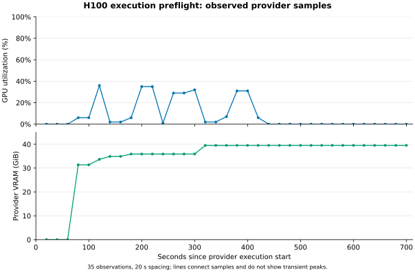

# H100 execution preflight (2026-11-07 KST)

One pretrained Llama-3.2-1B-Instruct run on NVIDIA H100 80 GB completed at
source `cead89d728a2713d1dc93312b71a5cc6ccef3e56` using
`configs/arc_sleep_v2.json`, seed 42, and training task `44f52bb0`. The provider
confirmed success and the process exited 0. This is **not an ARC benchmark
result**: no final evaluation targets were scored.

| Measurement | Value |
| --- | ---: |
| Wake steps / level-0 consolidations | 4 / 4 |
| Max absolute initial conversion-logit difference (four-token probe) | 0 |
| Base / inner / outer parameter L1 changes | 102.9051 / 11742.5641 / 2470.9443 |
| Peak CUDA allocated / reserved | 32.94 / 38.79 GiB |
| Preflight elapsed (excludes container setup) | 667.74 s |
| Diagnostic checkpoint and RNG restoration | Passed |
| Generated directive valid | No |
| Held-out **training** demonstration score | 0 |

The model generated a grid before its directive JSON. Strict parsing classified
that output as invalid. The preflight then used its predetermined identity
fixture to test optimizer, adapter, and checkpoint behavior; it did not accept a
model-generated candidate or train the real policy. No expert-by-expert counts
are available in the serialized report.

[Report](report.json) includes the resolved config, model revision, data and
protocol hashes, original generated text, loss traces, fixture scope, and source
report SHA256. Only the job identifier and private checkpoint path were omitted.
[Environment](environment.json) records the hardware and CUDA/PyTorch versions.
The container digest is in the report. No gated weights or checkpoints are
redistributed. A separate fresh job is needed for actual train/evaluate results.

[Provider GPU metrics](provider_gpu_metrics.csv) contain **35 real observations**
at 20-second intervals, from 20 through 700 seconds after the provider's
execution start. GPU utilization averaged **8.5% across these samples**, with a
sampled maximum of **36.0%**. The maximum sampled provider VRAM usage was
**39.53 GiB**. Utilization fractions were converted to percent, VRAM bytes to
GiB (`bytes / 2^30`), and timestamps to elapsed seconds; no missing observations
were filled and no values were synthesized. The provider CLI's displayed
percentage summary confirmed the utilization conversion.

The points are coarse provider measurements; connecting lines are visual guides.
They can miss brief peaks and do not identify individual execution phases or
establish kernel efficiency. The sampled mean covers the full observed window,
including setup and CPU/offload/checkpoint/I/O work. Provider VRAM usage includes
memory outside PyTorch's allocator and is different from the run-wide CUDA
allocated/reserved maxima above. Allocated and reserved memory overlap and must
not be added together. This trace supports memory-fit evidence for this one
execution; it supplies no ARC accuracy or throughput result.

The metrics were retrieved read-only for the completed execution. Source response
SHA256: `c601a5d8397cc5e12aeed91aed2a38e6e92cf77b0eb9ddaafc125e481a789289`.
The CSV and SVG contain elapsed times and measurements, without account or job
identifiers.
